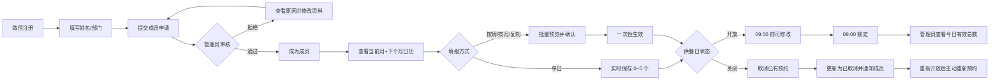

# 鸡蛋预约小程序产品设计文档

版本：V1.0（评审稿）  
状态：待业务评审  
更新时间：2026-09-22

## 1. 产品概述

这是一个面向同事早餐场景的鸡蛋预约小程序。成员可以一次填写未来一周或一个月的每日鸡蛋数量，管理员按日期查看当天需要蒸煮的鸡蛋总数，并根据节假日或特殊情况开放、关闭具体供餐日。

首版目标是把“口头报数、人工记忆、每天重复询问”变成可追踪的预约与汇总流程。

## 2. 产品目标与非目标

### 2.1 目标

- 成员一次性维护当前月和下一个月的鸡蛋需求。
- 管理员进入后优先看到今日有效蒸蛋总数。
- 管理员可以选择任意单日控制是否供餐，不限制过去、当天或未来日期。
- 供餐日关闭、预约取消等影响能够及时通知成员。
- 区分“未上报”和“明确不吃”，帮助管理员发现填报遗漏。

### 2.2 首版不做

- 不做 Excel 或其他文件导出。
- 不接入微信订阅消息；先使用小程序内弹窗和通知中心。
- 不做主动催填提醒。
- 09:00 后不允许管理员改动当天预约。
- 不删除成员，只支持停用与重新启用。

## 3. 角色与权限

### 3.1 注册用户

完成微信小程序注册，但尚未获得预约资格的用户。注册资料包括：

- 头像、昵称：通过微信官方头像昵称填写能力提供，其中头像由用户主动选择，昵称由用户填写或选用微信推荐内容；
- 真实姓名：必填，可修改；
- 部门：必填，可修改；
- 手机号：选填，可经用户授权从微信获取，也可手动输入。

注册用户需要提交成员申请，进入“审核中”。审核通过后成为成员。

### 3.2 成员

审核通过后可提交鸡蛋预约的用户。成员修改真实姓名、部门或手机号无需再次审核。成员停用后不能访问其他页面或执行任何操作，只能看到“已被停用”页面。

### 3.3 管理员

管理员可：

- 审核成员申请；
- 管理供餐日状态；
- 查看每日汇总和成员明细；
- 停用或重新启用成员；
- 添加或撤销同级管理员；
- 查看关键操作日志。

首位管理员由产品初始化指定，后续管理员拥有同等权限。系统必须始终保留至少一名管理员。

## 4. 核心业务规则

### 4.1 预约窗口与供餐日

- 可预约范围：当前自然月 + 下一个自然月。
- 默认供餐日历：周一至周五开放，周六、周日关闭。
- 管理员对具体日期的设置优先于默认日历。
- 管理员在月历中选择单日后开放或关闭供餐。
- 批量设置没有受影响预约时可直接执行；有受影响预约时，必须先展示影响日期、成员数和预计取消数量，再二次确认。

### 4.2 每日预约数量

- 每位成员每天最多预约 5 个鸡蛋。
- 数量为非负整数。
- 未填写 = 未预约，表示成员尚未上报，不计入有效总数。
- 明确填写 0 = 零数量预约，表示成员确认当天不吃，属于已上报状态，但不增加鸡蛋总数。
- 关闭供餐日不能新增或修改预约。

### 4.3 保存与截止

- 单日数量改动实时保存，成功后立即生效。
- 按周、按月或复制填充属于批量操作；应用前展示受影响日期和新数量，用户确认后一次性生效。
- 批量操作跳过关闭供餐日。
- 供餐日当天 09:00 为预约截止时间，按中国标准时间执行。
- 09:00 前成员可新增或修改当天预约；09:00 起当天预约成为锁定预约。
- 锁定后成员和管理员都不能修改当天预约。

### 4.4 供餐日关闭与预约取消

- 关闭供餐日会自动取消该日所有既有有效预约。
- 预约记录状态改为“已取消”，不计入有效预约总数；系统不单独保留预约历史。
- 重新开放后，已取消预约不自动恢复，成员需主动重新预约。
- 成员重新预约时，直接覆盖此前的“已取消”状态，只保留最新预约状态。
- 关闭或开放供餐日都要通知所有审核通过的成员。

### 4.5 成员停用与启用

- 管理员不能删除成员，只能停用成员。
- 停用时，自动将该成员所有尚未锁定的未来有效预约改为“已取消”并通知成员；不单独保留预约历史。
- 已经过 09:00 的锁定预约不受停用操作影响。
- 停用成员重新启用后恢复成员资格，但已取消预约不自动恢复，成员需主动重新预约。

## 5. 成员端产品设计

### 5.1 页面结构

1. 登录/注册页
2. 成员申请资料页
3. 审核中状态页
4. 我的预约日历（成员首页）
5. 批量填报页
6. 日期预约编辑页
7. 通知中心
8. 个人资料页
9. 已被停用页

### 5.2 成员首页：我的预约日历

- 展示当前月与下一个月。
- 每天展示日期、供餐状态、我的数量和预约状态。
- 状态至少包括：已预约、零数量预约、未预约、已取消、已锁定、关闭供餐。
- 突出最近一个尚未完成填报的开放日期，但不发送主动催填通知。
- 右上角提供通知图标和未读标记。

### 5.3 填报方式

- 单日编辑：选择 0～5 个，修改后实时保存。
- 按周填充：选择一周内日期并批量设置数量。
- 按月填充：对当前可预约日期批量设置数量。
- 复制填充：将某日或某周数量复制到其他选定日期。
- 批量确认页展示将修改的日期、关闭供餐日跳过情况和数量变化；确认后整体生效。
- 保存失败时保留当前输入并提示重试，不能静默丢失。

### 5.4 成员通知

- 用户进入小程序时，如存在未读通知，弹出最新一条。
- 用户点击“已读”后，该通知不再弹出。
- 有多条未读通知时只弹出最新一条，其余通知保留在通知中心。
- 通知中心保留历史通知，按时间倒序展示。
- 供餐日开放/关闭通知发送给所有审核通过的成员。
- 关闭通知需说明日期、原预约数量及已取消结果。
- 审核通过、拒绝、停用、重新启用等成员状态变化也应形成站内通知。

## 6. 管理员端产品设计

### 6.1 管理员首页

首页首要展示“今日需煮鸡蛋总数”，即今日开放供餐日内所有有效预约数量之和。

辅助信息：

- 今日已填报成员数；
- 今日未预约成员数；
- 今日明确填 0 的成员数；
- 今日已取消预约数；
- 未来日期按日汇总的有效预约总数。

点击某日进入日期明细，可查看成员、当前数量、当前预约状态和填报状态。

### 6.2 成员审核

- 审核列表按待处理、已通过、已拒绝、已停用筛选。
- 申请详情展示微信头像/昵称、真实姓名、部门、手机号（如有）、申请时间和历史审核记录。
- 通过后用户成为成员并可预约。
- 拒绝时填写拒绝原因；用户可修改资料后重新提交。
- 成员资料后续修改无需重新审核。

### 6.3 供餐日管理

- 日历展示默认状态与管理员覆盖状态。
- 支持单日开放/关闭。
- 点击月历中的日期后，仅对该日期执行开放/关闭。
- 影响已有预约时显示影响预览和二次确认。
- 操作成功后生成通知和操作日志。

### 6.4 管理员管理

- 已通过成员可被设置为管理员。
- 管理员可撤销其他管理员身份，但不能撤销最后一名管理员。
- 所有管理员拥有相同权限。

## 7. 状态模型

### 7.1 成员状态

`注册用户 → 审核中 → 已通过成员 → 停用成员`

审核中可转为已拒绝，已拒绝可修改资料后再次进入审核中；停用成员可被重新启用为已通过成员。

### 7.2 每日预约状态

`未预约 → 已预约 / 零数量预约 → 锁定预约`

开放供餐日关闭时，既有预约当前状态改为“已取消”；重新开放不恢复，成员重新预约时直接覆盖为最新状态。单日数量变更在截止前实时保存。

## 8. 关键场景

### 场景一：成员按月填报

成员打开预约日历，进入按月填充，设置工作日数量，系统跳过周末和关闭供餐日，展示变更预览，成员确认后一次性保存。

### 场景二：管理员关闭节假日

管理员选择单日关闭供餐。系统发现当天已有预约，展示受影响成员数、预约数量和预计取消数量；管理员确认后取消预约、更新有效总数、发送通知并记录日志。

### 场景三：成员忘记填报

管理员打开某日明细，看到“未预约”成员数量及名单。成员未填写不等于填 0，管理员可据此线下提醒；系统首版不自动催填。

### 场景四：成员被停用

管理员停用成员。系统将其未来未锁定预约改为“已取消”并通知成员。成员下次进入小程序直接看到停用页，无法访问预约、通知或资料页面。

## 9. 通知与日志

### 9.1 通知类型

- 供餐日开放；
- 供餐日关闭及预约取消；
- 成员申请通过；
- 成员申请拒绝及原因；
- 成员被停用；
- 成员被重新启用。

首版仅提供小程序内弹窗和通知中心；微信订阅消息作为后续增强能力。

### 9.2 关键管理员操作日志

至少记录：操作人、操作时间、操作类型、目标对象、变更前状态、变更后状态及必要原因。日志覆盖成员审核、供餐日开关、批量供餐设置、成员停用/启用、管理员任命/撤销。

## 10. 首版验收重点

- 成员只能在审核通过且未停用时预约。
- 当前月和下一个月的开放日期可预约，关闭日期不可预约。
- 每人每天不能超过 5 个；未填写与明确填 0 在管理员统计中可区分。
- 单日改动实时保存，批量改动确认后整体生效。
- 09:00 后成员和管理员都不能改当天预约。
- 关闭供餐日会将既有预约状态改为“已取消”，不计入有效总数；重新预约时覆盖为最新状态。
- 重新开放或重新启用不会自动恢复已取消预约。
- 通知弹窗只展示最新一条未读通知，历史通知可从通知中心查看。
- 停用成员无法进入其他页面，且关键管理员操作可追溯。

## 11. 待评审事项

以下事项已按当前讨论形成推荐方案，若你希望调整，可以在评审时逐条修改：

1. 重新启用成员后不自动恢复已取消预约；
2. 首版按中国标准时间执行 09:00 截止；
3. 首版只做小程序内通知，不接微信订阅消息；
4. 首版不做数据导出和主动催填；
5. 所有管理员同权，系统保留至少一名管理员。

## 12. 业务流程图

交互原型包含成员端预约日历、管理员端今日汇总、通知弹窗与历史通知状态，可直接打开查看：

[鸡蛋预约小程序-流程与原型.html](./鸡蛋预约小程序-流程与原型.html)
